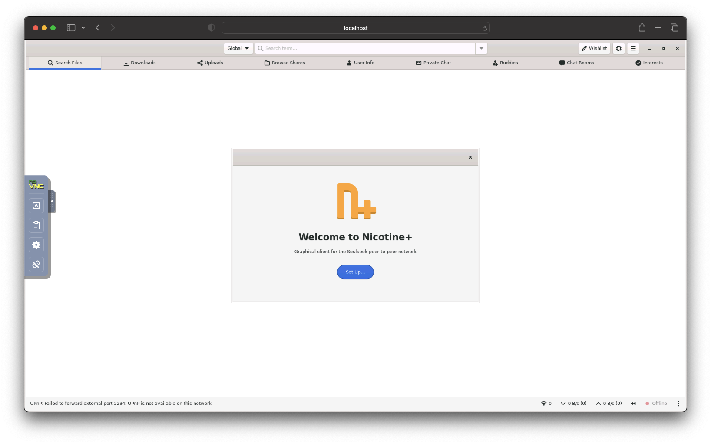
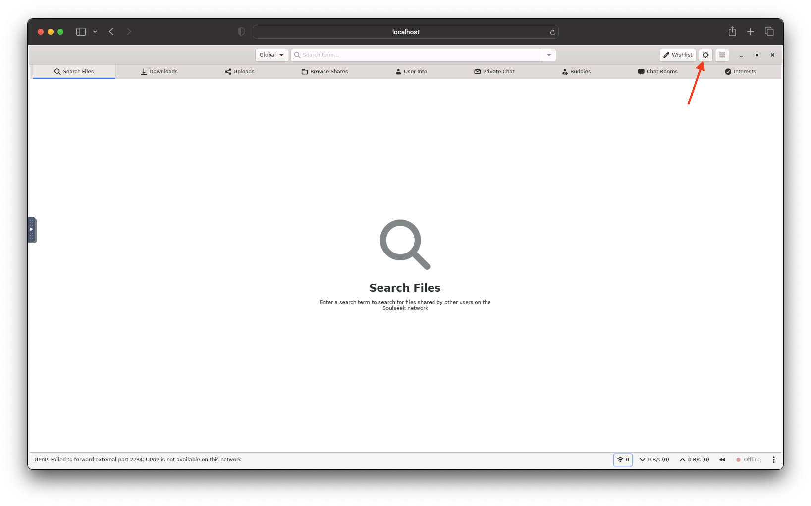
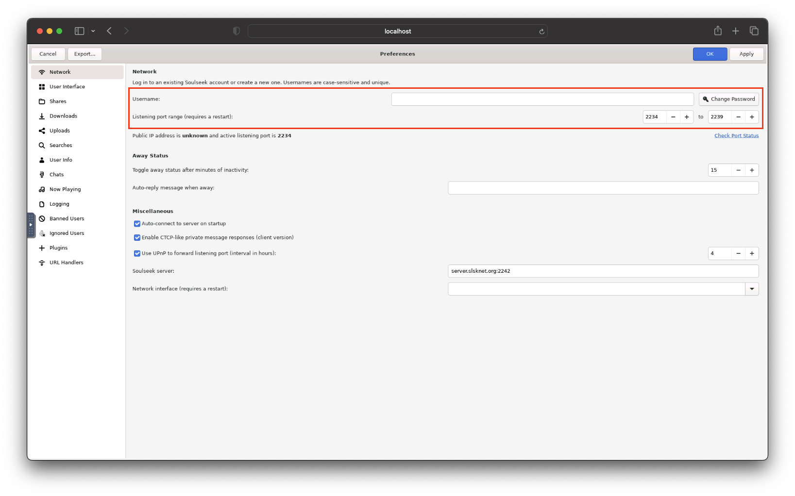
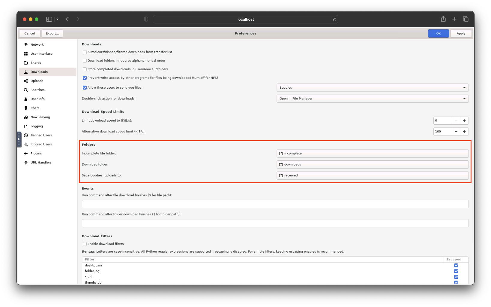
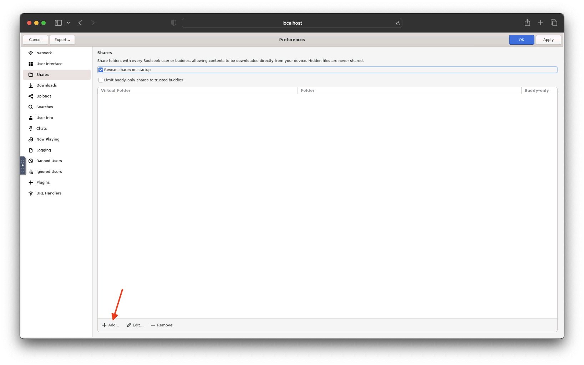

# [Docker Nicotine+](https://github.com/mrgasparov/nicotine-novnc)

[](https://github.com/mrgasparov/nicotine-novnc/actions/workflows/docker-build.yml)

[Nicotine+](https://nicotine-plus.org/) is a graphical client for the Soulseek peer-to-peer network. It aims to be a lightweight, pleasant, free and open source (FOSS) alternative to the official Soulseek client, while also providing a comprehensive set of features.

[noVNC](https://novnc.com) is an open source VNC client which is both a VNC client JavaScript library as well as an application built on top of that library.

This Docker image runs Nicotine+ on a Raspberry Pi, NAS, or computer and gives you access through a browser. The desktop uses GTK4 and an integrated TigerVNC display, with SVG icons, transparent menus, and compositing configured to prevent black rendering artifacts. The display replaces separate Xvfb and screen-capture processes, with VNC updates capped at 30 per second to limit encoding work.

The main window fills the desktop. Dialogs such as About open centered, can be closed with the mouse, and have visible borders and soft shadows to distinguish overlapping windows.

### Included versions

| Component | Version |
| --- | --- |
| Nicotine+ | 3.3.11 |
| noVNC | 1.7.0 |
| websockify | 0.13.0 |
| Base image | Debian trixie-slim |

These are the versions pinned in this repository; published images are updated through tagged releases.



## Supported Architectures

Simply pulling `mrgasparov/nicotine-novnc:latest` should retrieve the correct image for your architecture. The list of supported architectures is the following:

| Architecture | Available | Devices
| :----: | :----: | ---
| x86-64 | ✅ | Synology NAS, PC, Intel Mac
| arm64 | ✅ | Raspberry Pi 4, Apple Silicon
| armhf | ✅ | Raspberry Pi 3

## Deployment

The browser endpoint has no login protection or TLS by default. Use it on a trusted network, or put it behind an authenticated HTTPS reverse proxy before allowing remote access.

### Docker Compose

Download [`compose.yaml`](./compose.yaml), adjust the host volume paths and
`PUID`/`PGID` for your machine, then run `docker compose up -d`.

```yaml
services:
  nicotine:
    image: mrgasparov/nicotine-novnc:latest
    container_name: nicotine
    restart: unless-stopped
    environment:
      - RESOLUTION=1920x1080
      - NOVNC_PORT=6080
      - PUID=1000
      - PGID=1000
    ports:
      - "6080:6080" # UI port
      - "2234-2239:2234-2239" # Listening port range
    volumes:
      - /home/user/nicotine/data:/data
      - /home/user/nicotine/downloads:/downloads
```

### Docker CLI

```bash
docker run -d \
  --name=nicotine-novnc \
  -e NOVNC_PORT=6080 \
  -e RESOLUTION=1920x1080 \
  -e PUID=1000 \
  -e PGID=1000 \
  -p 6080:6080 \
  -p 2234-2239:2234-2239 \
  -v /home/user/nicotine/data:/data \
  -v /home/user/nicotine/downloads:/downloads \
  --restart unless-stopped \
  mrgasparov/nicotine-novnc:latest
```

## Usage

1. Open `http://<device-ip>:6080` in your browser.
2. Open Preferences.

   

3. Enter your Soulseek username and password and choose a listening port within the published range (`2234-2239` in the examples). For inbound connections from outside your network, forward that TCP port on your router to the Docker host. Nicotine+ 3.3.11 disables automatic router port forwarding in Docker.

   

4. Choose your download and incomplete-download folders under `/downloads` so files persist on the host.

   

5. Choose folders to share under `/downloads`.

   

## Parameters

### Environment Variables

| Variable | Description | Required | Default
| :----: | --- | :---: | :---:
| `NOVNC_PORT` | Browser port inside the container; match the container side of the port mapping | No | `6080`
| `RESOLUTION` | Desktop size in `WIDTHxHEIGHT` format; applied at container startup | No | `1280x720`
| `PUID` | Match internal user ID to the ID of your host user. Needs `PGID` to be set | No | `0` (root)
| `PGID` | Match internal group ID to the ID of your host group. Needs **`PUID`** to be set  | No | `0` (root)
| `UMASK` | Defines permissions for newly created files  | No | `0000`
| `TZ` | Time zone, such as `Europe/Berlin` | No | Base image default (UTC)

Set both `PUID` and `PGID` to nonzero values to run the desktop as that user. On Linux, use `id -u` and `id -g` to find your IDs, and make sure that user can write to both mounted host directories. Startup adjusts ownership of `/data`; it does not change ownership of the mounted `/downloads` directory.

To change only the host browser port, use a mapping such as `7080:6080` and leave `NOVNC_PORT=6080`. Recreate the container after changing environment variables in Compose.

### Volumes

| Volume | Description
| :----: | ---
| `/data` | Path to persistently mount Nicotine+ application data and configuration
| `/downloads` | Path to persistently mount download folder

## Updating

Back up `/data` before upgrading. For Compose deployments, keep your volume paths and run:

```bash
docker compose pull
docker compose up -d
```

For Docker CLI deployments, pull the image and recreate the container using the same volume paths and settings. Keep both host directories to retain configuration and downloads.

The default dialog border stylesheet is installed at `/data/.config/gtk-4.0/gtk.css` when that path does not already exist. Existing custom styles are preserved; see [troubleshooting](./docs/troubleshooting.md) if borders are missing after an upgrade.

## Documentation

- [Troubleshooting](./docs/troubleshooting.md): browser access, NAS responsiveness, rendering, dialog borders, permissions, and incoming connections.
- [Development](./docs/development.md): local builds, version pins, desktop components, and tests.

## Acknowledgements

This Docker image is based on the excellent [realies/soulseek-docker](https://github.com/realies/soulseek-docker), which uses SoulseekQT instead of Nicotine+.
